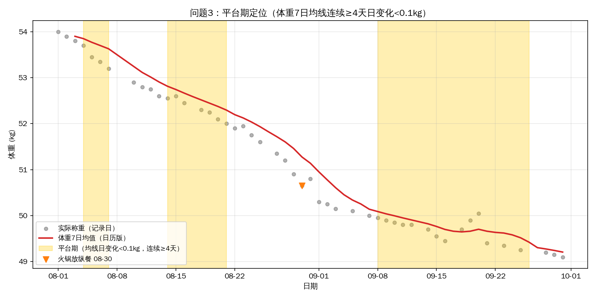

# 减脂数据分析 | 从记录到决策的完整闭环
 
> 基于 61 天（50 个有效记录日，49 称重日 = 50 − 1，09-24 未称重）自我追踪减脂数据，独立完成
> **取数 → 清洗 → 口径设计 → 分析 → 可视化 → 行动建议** 的完整分析闭环，全链路 Pandas + SQL 双实现交叉对账，
> 所有方法可直接迁移到业务数据场景。
 
## 核心发现
 

 
| 发现                                              | 数据             | 决策                   |
| ----------------------------------------------- | -------------- | -------------------- |
| 热量 956→1245 kcal 后，周减重 -0.66→-0.25 kg，**方向未反转** | 周度对比，42 个有效记录日 | 维持 1200–1300 kcal 档位 |
| 有氧进步集中在单车（17.1→24.2 km/h，+41%），其余项目平稳           | 分动作配速散点        | 用过程指标补结果指标盲区         |
| 规则判定的平台期（09-08~09-26）与主观感受"卡在51"**不一致**         | 7日均线 + 阈值规则    | 用统一规则替代情绪判断          |
| 双口径 / 插值 / 平台期 / 观察性四项验证全部通过，主链结论稳健             | `sql/08~11` 验证层 | 结论写死前先过 SQL 对账（见下表）  |
 
## 双实现对账总表
 
| 分析问题 | Python 结论 | SQL 对账结果 | 判定 |
| --- | --- | --- | --- |
| Q1 热量上调后减重是变慢还是变稳 | 956→1245 kcal，周减 -0.66→-0.25 kg，方向未反转 | `03a` 月均 956 kcal / 73 g、1245 / 92；`03b` 周减重速度逐周对齐，核心指标偏差 <0.1% | 一致 |
| Q2 有氧表现进步了吗 | 单车 17.1→24.2 km/h（+41%），其余平稳 | `04` 单车 n=4（17.1→24.2）、跑步 ≈8.0、游泳/快走 ≈1.5 | 一致 |
| Q3 平台期到底在哪几天 | 09-08~09-26，19 天（约 50 kg 一带） | `05` gaps-and-islands 同段 19 天；`10` 对照实验确认判定必须锚定日历轴 | 一致 |
| Q4 训练频率是否稳定 | 最后两周"变少"为记录偏差，反查为真实 3 练 | `06a/06b/06c` 练了未记 4 天、反向 0 行、时长差 0 行；`06d` 周训练密度对账 | 一致 |
| 补充：`ma7_py` 列能否作对账基准 | 原始 CSV 遗留列：末端 49.25、非空 43 天 | `08`⑤ 对账：min_periods 未知（跳NaN 机制同族已复现 49.24，差 0.01）、非空 43（含 1 处越界）、末端 49.25（化石） | 不可复现的化石列：不作对账基准，弃用或重算 |
 
## 审计发现清单
 
SQL 重建过程中审计出的记录与口径问题（已回写 `data_quality.md` 与报告）：
 
1. 完整记录日最小热量是 840 非 870（800 阈值仍成立：640/720 < 800 < 840）；
2. 09-08 为事后补录日，数值按实测保留并标注补录来源；
3. 09-24 为半记录日——整行存在但体重 NULL（留出验证 n=47 的成因）；
4. 平台期判定对日变化取绝对值（ABS 处理），起止日均线回表取值；
5. SQL"先过滤再开窗" vs Pandas"先开窗再跳 NaN"：末端读数 49.36 vs 49.25，差 0.11 kg；
6. `ma7_py` 为不可复现的遗留列（化石列）：末端 49.25 与"含 NULL 行开窗跳 NaN"机制同族（当前数据复现得 49.24，差 0.01 恰说明数据状态不同）；非空 43 天与任何单一算法矛盾；另有 1 处越界取值。判定生成于旧版数据、无脚本可复现。处理：不作对账基准，弃用或重算；
7. 第 39 周表面骤降 → 反查记录密度 → 真实 3 练（记录偏差，非训练减少）。
 
## 验证层（sql/08~11）
 
方法论审计脚本，均自包含（仅依赖 `daily_clean`），只引用主链结论、不参与主链计算：
 
### 08 双口径 gap 对账
 
47 个共同记录日上，日历版与记录日版均线平均绝对差 0.06 kg、最大 0.275 kg（09-28，缺失最密集段）；末端读数 49.21（日历版）vs 49.36（记录日版）。补刀核查：跳NaN机制在当前数据独立复现末端 49.24（化石 49.25，差 0.01 → 底层数据状态不同）；越界检查 out_of_band=1（体重缺失日仍有均值）→ 化石判定实锤。
 
### 09 插值留出验证
 
单点留出 n=47：mean 0.066、max 0.417 kg（09-21），8 天误差 >0.1 kg；经 7 日均线平滑后最大扰动降至 0.032 kg（约 13 倍稀释），平台期内插值误差 ≤0.025 kg。
 
### 10 平台期记录日轴对照
 
同一规则换到记录日轴：检出 3 段（4/6/14 天），8 月段被截短、9 月段延伸至 09-29，边界双向漂移 → 平台期判定必须锚定日历轴。
 
### 11 训练日 vs 非训练日（观察性对比）
 
训练日 n=25 vs 非训练日 n=17：热量差 -64 kcal（t²=0.77）、睡眠差 -0.02 h（t²=0.02），均不显著。
 
> 观察性研究声明：分组非随机（训练日存在自选择），差异只能解释为关联、不能解释为因果；若需因果结论需要随机化实验设计——这也是 A/B 测试的核心价值。
 
## 技术要点
 
- **缺失分类处理**：状态量（体重）插值、行为量（热量）留空、真零值（训练量）填0——不造数
- **双口径分离**：日历版（均线/趋势）与记录日版（周均值）并存不混用，修复 rolling 跨缺失日失真
- **交叉校验**：两表比对定位 4 天"练了未记"的记录缺陷，反向校验 0 差异
- **可证伪预测**：10 月对账验证因果链（写入报告第八节）
 
## 文件导航
 
| 文件                                           | 内容                                    |
| -------------------------------------------- | ------------------------------------- |
| [减脂数据分析报告.md](./减脂数据分析报告.md)                 | 完整报告（执行摘要 → 数据治理 → 4个分析问题 → 因果边界）     |
| [fitness_analysis.py](./fitness_analysis.py) | 全部代码，`python fitness_analysis.py` 可复现 |
| [data_quality.md](./data_quality.md)         | 缺失日归因、填0原则、口径偏差说明                     |
| `data/import_to_sqlite.py`                   | SQLite 建库脚本（daily_clean + train_log → fitness.db） |
| `sql/`                                       | 15 个 SQL 脚本：`00~06d` 主链回答四个问题，`08~11` 验证层做方法论审计 |
| `results/`                                   | 关键结果截图（SQL 实测输出与图表对照）                 |
| charts/                                      | 4 张图（趋势/散点/柱状/平台期标注）                  |
| data/fitness_daily_clean.csv                 | 清洗后数据                                 |
 
## 复现
 
```bash
pip install pandas matplotlib
python fitness_analysis.py
```
 
SQL 对账层（双实现交叉验证）：
 
```bash
python data/import_to_sqlite.py    # ① 建库：生成 fitness.db（daily_clean + train_log）
sqlite3 -header -column fitness.db < sql/00_date_spine.sql    # ② 主链：sql/00~06d 按序执行
sqlite3 -header -column fitness.db < sql/08_caliber_gap.sql   # ③ 验证层：sql/08~11（08/09 用临时表，须整段按序跑）
```
 
## 技术栈
 
`Python` `Pandas` `Matplotlib` `Excel数据源` `SQL` `SQLite` `DB Browser`
 
---
 
📊 分析周期：2026-08-01 ~ 09-30 ｜ 10 月对账数据收录后更新验证结论
