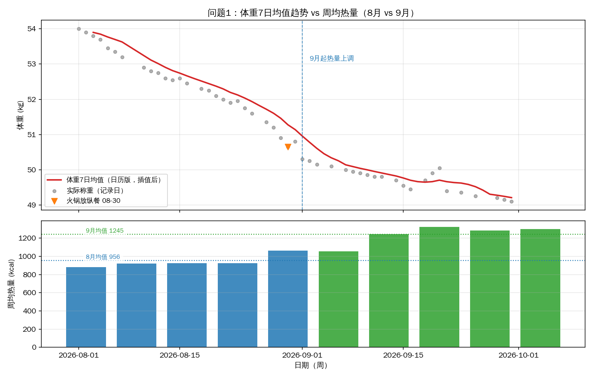
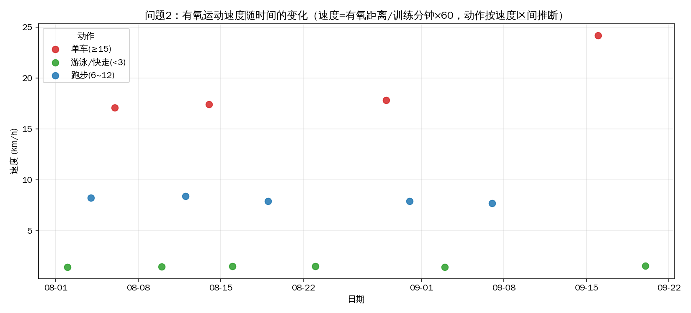
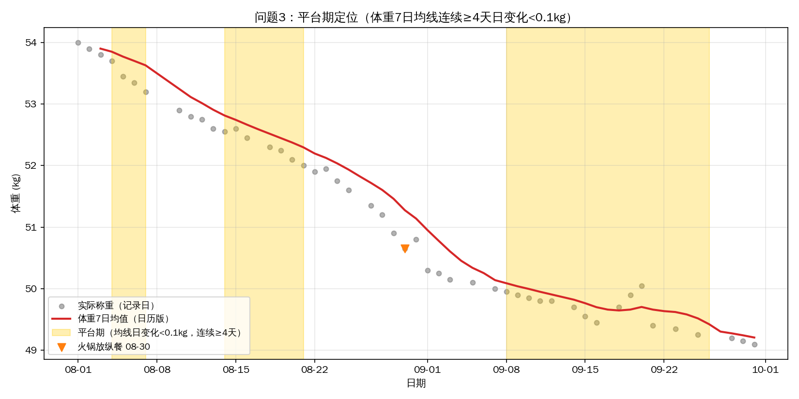
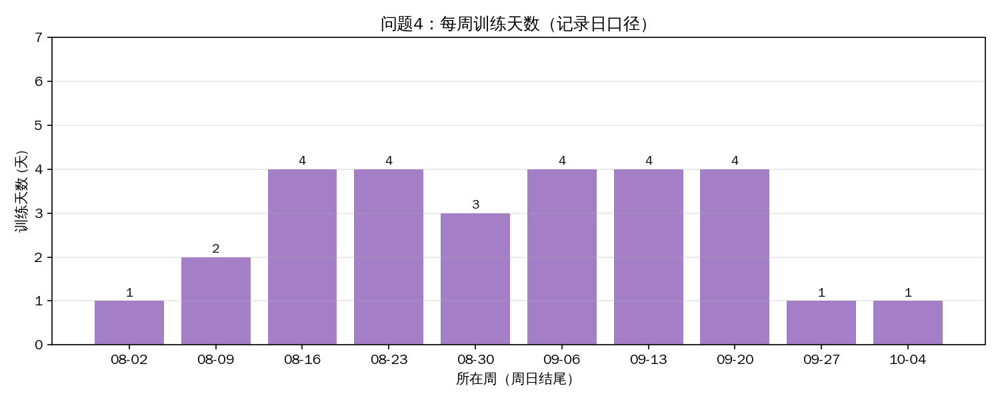

# 减脂数据分析报告 | 问题 → 口径 → 验证 → 迁移

> **一句话定位**：以本人 61 天（50 个有效记录日）真实减脂追踪数据为样本，独立完成一次完整的业务式分析闭环——问题定义 → 数据治理 → 口径设计 → 探索分析 → 决策输出 → 可证伪验证。所有方法可直接迁移到业务数据场景。
>
> 数据范围：2026-08-01 ~ 09-30（61 日历日，有效记录 50 天，缺失 11 天）
> 配套文件：`fitness_analysis.py`（可复现脚本）、`charts/`（4 张图）、`fitness_daily_clean.csv`、`data_quality.md`

---

## 一、执行摘要

**三个核心发现，对应三个可执行决策：**

| #   | 核心发现                                                                                  | 数据依据             | 支撑的决策                                      |
| --- | ------------------------------------------------------------------------------------- | ---------------- | ------------------------------------------ |
| 1   | 日均热量从 956 上调至 1245 kcal 后，周减重从 -0.66 kg 收窄至 -0.25 kg，**方向未反转**；同期蛋白质 73→92 g、训练频率两月相当 | 周度对比，42 个有效热量记录日 | **维持 1200–1300 kcal 档位**。"变慢"不构成退回极端节食的理由  |
| 2   | 有氧表现进步集中在单车（17.1 → 24.2 km/h，**+41%**），跑步与游泳/快走均维持稳定                                  | 分动作散点（4/5/6 次）   | 结果指标不动时，需引入**过程指标**（配速）评估努力是否有效            |
| 3   | 主观感受"卡在 51"与规则判定不一致：均线识别的最长平台期在 09-08 ~ 09-26、约 50 kg 一带                              | 日历版 7 日均线 + 阈值规则 | 建立"均线连续 ≥10 天日变化 <0.1 kg 才触发方案调整"的**统一规则** |

**数据一致性说明**：全文关键数字口径统一——61 日历日 / 50 有效记录日 / 49 称重日 / 42 有效热量记录日（50 减去 7 个部分记录日）/ 11 缺失日（其中 4 天“练了未记”，由 3.5 节交叉校验发现）。

**下月可证伪预测**（10 月数据对账即可验证因果链）：

- 维持 1250 kcal → 预期周减 0.2–0.3 kg
- 退回 900 kcal → 预期周减回到 0.5 kg 以上

---

## 二、业务问题定义：三个问题对应三类典型分析场景

| 分析问题            | 场景类型           | 业务对应示例                            |
| --------------- | -------------- | --------------------------------- |
| 热量上调后减重是变慢还是变稳？ | **策略效果评估**     | 新定价/新功能上线后，核心指标变化是策略带来的吗？         |
| 有氧表现进步了吗？       | **过程指标监控**     | 结果指标（GMV/留存）不动时，过程指标（活跃/转化）是否在改善？ |
| 平台期到底在哪几天？      | **异常 vs 噪声识别** | 指标波动是异常需要干预，还是正常噪声？               |
| （问题 4）训练频率是否稳定？ | **混杂变量排查**     | 对比分析前检查潜在混杂因素（流量、时段、渠道）           |

**为什么选这三个问题**：每个问题的答案都能直接指导下一步行动（见第四节各问题结论），而不是"为了分析而分析"。

---

## 三、数据治理与口径设计（严谨性证明）

### 3.1 取数与清洗：七步闭环

从取数到导出的完整过程可复现如下（对应岗位职责中的“独立取数—清洗”环节；方法可直接迁移至业务数据的取数—清洗流程）：

```
【取数】每日记录（一天一行）+ 训练日志（一天多行，覆盖32天）
          → 两表粒度不同（与业务中"订单表/日志表粒度不一致"同构），需合并对齐
【清洗】Step1 数据体检（热量缺7 / 睡眠缺10 / 体重缺3）
        Step2 日历对齐（61天理论日历 → difference 定位11个缺失日）
        Step3 特殊日打标不删数
        Step4 双表合并（日志按日聚合 → left merge → 休息日训练量填0）
        Step5 交叉校验（两表比对，发现记录缺陷）★
        Step6 特征工程（7日均线、有氧配速、ISO周）
        Step7 导出 fitness_daily_clean.csv（utf-8-sig）
```

### 3.2 缺失分类与差异化处理

**核心原则：状态可估、行为不造、真零填零。**

| 变量类型   | 例子        | 处理               | 理由                              |
| ------ | --------- | ---------------- | ------------------------------- |
| 生理连续量  | 体重        | 时间插值，**仅用于均线计算** | 日间波动连续，仅缺 3/49 天，插值误差极小         |
| 行为不连续量 | 热量、蛋白质、睡眠 | 留空 NaN           | 漏记日多为外食/聚餐，真实值倾向更高，补数等于编造且方向性错误 |
| 真实零值   | 训练分钟、有氧距离 | 填 0              | 休息日训练量为事实，不是缺失                  |

**业务对应**：GMV/销售额等趋势型指标可按趋势估补；用户行为日志、交易明细等事件型数据不可造。

### 3.3 特殊值二分法

- **部分记录日**（热量缺失或 <800 kcal，共 7 天）：记录不完整 → 剔除出均值计算；
- **特殊事件日**（08-30 火锅 1850 kcal）：记录完整、数值真实 → 保留 + 图上标注 + 解读时单独说明。

**区分原则**：低质量记录（不可信）剔除出统计；真实极端值（可信但不典型）标注后保留。删除后者等于美化数据。

### 3.4 口径分离（本项目最关键的设计决策）

| 口径       | 用途               | 业务对应             |
| -------- | ---------------- | ---------------- |
| **日历版**  | 体重趋势、周减重速度、平台期判定 | 自然日口径（DAU、日 GMV） |
| **记录日版** | 周均热量、蛋白质、训练天数    | 活跃日口径（活跃用户均值）    |

两套口径并存、不混用、所有图表标题注明。原因：`rolling(7)` 数的是"行"而非"天"，缺失 11 天会让原始均线窗口实际横跨 10+ 个日历日，趋势失真；重建日历索引后插值 + 固定 7 天窗，均线才真正反映"7 天"。

校验：日历版均线 53.90 → 49.21 kg，与原始体重 54.0 → 49.1 kg 一致，未引入系统性偏移。

### 3.5 数据质量监控（交叉校验结果）

- 训练日志有记录、但每日表整行缺失：**4 天**（09-13/17/22/26）
- 每日表标记训练日=1、但训练日志无记录：**0 天**（该方向两表完全一致）

*（其余清洗规则详见 `data_quality.md`，含缺失日归因、填 0 原则、口径偏差说明，此处不重复）*

---

## 四、四个分析问题

### 问题 1：热量上调后，减重是变慢还是变稳了？（策略效果评估）



> 图注：体重是连续"状态"，折线连线表达"日间渐变"；热量是每日独立"事件"，用柱状——画连线会错误暗示存在中间过渡。图型即语义。

- **发现**：热量 956→1245 kcal/天，周减重速度从 8 月约 -0.66 收窄到 9 月约 -0.25 kg/周（降至约四成），方向未反转；蛋白质 73→92 g 同步上调。
- **行动**：维持 1200–1300 kcal 为 10 月默认档位——经过两个月标定的"可持续减脂档位"。
- **业务对应**：策略效果评估时，需同时检查混杂变量（如训练频率、蛋白质摄入方向），避免把相关性当因果。

### 问题 2：有氧表现进步了吗？（过程指标监控）



> 图注：日期 × 配速是两个连续量的关系，且需分动作比较 → 散点。

- **发现**：单车 4 次 17.1→24.2 km/h（+41%）；跑步（均值约 8.0 km/h）、游泳/快走（约 1.5 km/h）点位基本水平——**不进步的也如实画出**，避免"整体进步"的错觉。
- **行动**：进步集中在单车；只说"表现进步"，不说"体能提升"（无对照）。
- **业务对应**：结果指标停滞时，过程指标是判断"努力是否白费"的关键证据；避免因结果不动而否定全部投入。

### 问题 3：平台期到底在哪几天？（异常 vs 噪声识别）



> 图注：散点画原始称重（不碰原值），均线承载趋势，axvspan 把规则判定结果直接标上图。

- **发现**：规则（均线连续 ≥4 天日变化 <0.1 kg）标出最长平台期 09-08~09-26（19 天，约 50 kg 一带），与主观感受"卡在 51"位置不一致——**主观与数据不一致时，信规则**。
- **行动**：固化触发规则"均线连续 ≥10 天变化 <0.1 kg 才启动方案调整"，波动一律视为噪声。
- **业务对应**：异常判定必须用统一规则，不能靠主观感受；这是所有监控告警系统的设计底层。

### 问题 4（稳健性检查）：每周训练天数稳定吗？（混杂变量排查）



> 图注：分类量的规模比较 → 柱状。

- **发现**：8 月中旬起稳定在每周 3~4 练；末两周"变少"源于整行缺失——**没记录 ≠ 没练**（记录偏差，见 `data_quality.md`）。
- **作用**：为问题 1 排除"少练了"的替代解释。
- **业务对应**：对比分析前的稳健性检查，类似 A/B 测试前的流量一致性校验。

---

## 五、关键指标体系（分层设计）

| 层级       | 指标              | 角色           | 为什么关键             |
| -------- | --------------- | ------------ | ----------------- |
| **结果层**  | 体重 7 日均线（日历版）   | 唯一"说了算"的趋势指标 | 抹平单日水分波动，反映真实脂肪变化 |
| **行为层**  | 周均热量、蛋白质、每周训练天数 | 可直接控制的输入     | 改结果只能改输入          |
| **能力层**  | 有氧速度（分动作）       | 训练效果的过程证据    | 体重不动时，判断努力是否白费    |
| **可信度层** | 部分记录日、特殊事件日、缺失日 | 数据质量监控       | 决定哪些数字能信          |

**业务对应**：结果层 = 北极星指标，行为层 = 驱动指标，能力层 = 过程指标，可信度层 = 数据质量监控——这是任何业务指标体系的通用分层。

**全数据最有用的一条信息**：热量档位 ↔ 周减重速度的标定关系（900 档 ≈ -0.66 kg/周，1250 档 ≈ -0.25 kg/周）。它把"吃多少"从感觉问题变成了标定过的问题。

---

## 六、因果解读与结论边界

### 问题 1 的因果链最完整，理由有三

① 机制明确（能量缺口缩小 → 减速）；② 时序正确（9 月上调后速度随即收窄）；③ 排除主要替代解释（部分记录日已剔除、口径两月一致、训练频率相当、蛋白质方向相反）。

**但边界必须说清**：n=1、两个月、无对照，属于"强相关 + 机制支持"，不是实验级因果。

### 短期因果（机制清晰）

放纵餐/外食后 1–2 天体重 +0.15~0.35 kg 后回落（08-30 火锅 → 次日 +0.15；09-19 外食 → 09-20 +0.35 → 次日回落），是水分滞留，不是脂肪增加。**对应实践**：大餐后 48 小时内不看单日体重，只看均线。

### 问题 2、3 保持描述性

单车提速无对照，只陈述表现；平台期成因（体重基数变小、缺口缩小）是合理假设而非结论。

### 不可使用 / 需谨慎的结论

| 类型       | 指标/规则                  | 说明               |
| -------- | ---------------------- | ---------------- |
| ✅ 可立即使用  | 热量档位 → 速度的标定关系         | 10 月维持 1200–1300 |
| ✅ 可立即使用  | 平台期触发规则                | 规则触发才调整，杜绝情绪化操作  |
| ✅ 可立即使用  | 大餐后 48h 读数豁免           | 防止把水肿当反弹         |
| ⚠️ 规则型预测 | "维持输入 → 周减 0.2–0.3 kg" | 较可靠，10 月对账       |
| ⚠️ 外推型预测 | 按斜率外推 10 月底约 48 kg     | 仅作参考             |
| ❌ 不宜使用   | 单日体重、记录日均值直接外推         | 噪声与偏差均大          |

---

## 七、方法论沉淀（可迁移清单）

这一节是整份报告的"卖点"——**所有方法都可以原封不动搬到业务数据分析场景：**

| 本项目中使用的方法                | 业务数据分析对应场景                          |
| ------------------------ | ----------------------------------- |
| 记录日 vs 日历日口径分离           | 活跃用户口径 vs 自然日口径；广告投放的"展示日 vs 转化日"归因 |
| 部分记录日剔除出均值               | 会话时长不足 N 秒的用户不计入平均使用时长；首日新客不计入复购率   |
| 生理量可插值、行为量不可插值           | GMV 等趋势型指标可估补；点击流等事件型数据不可造          |
| 结果/行为/能力/可信度四层指标体系       | 北极星指标 + 驱动指标 + 过程指标 + 数据质量监控的标准分层   |
| 排除替代解释（训练频率相当、蛋白质方向相反）   | 对比分析前的混杂因素排查；类似 A/B 测试的流量一致性校验      |
| 可证伪预测（10 月对账）            | 策略上线前先写预期指标，周期结束后复盘是否兑现             |
| 规则化判定替代主观判断（平台期阈值）       | 异常检测阈值、业务告警规则的制定逻辑                  |
| 数据质量备忘录（data_quality.md） | 数据字典 + 口径文档——团队协作的基础设施              |

---

## 八、局限与后续迭代

**已知局限**：

- n=1、两个月、无对照，所有因果表述以 10 月对账为准
- 所有"日均"为记录日均值，漏记日摄入倾向偏高，绝对数值可能低估
- 动作分类来自速度区间推断，非原始字段

**记录端改进**：

- 4 天"练了但没记"暴露记录流程缺陷，建议训练日志与每日表打通或当天补录，缺失率从 18% 压到个位数
- 若训练日志增加"动作"原始字段，图 2 可从推断升级为严格版本

**10 月验证计划**：

1. 验证热量档位预测（1250 kcal → 周减 0.2–0.3 kg）
2. 验证平台期触发规则是否被触发
3. 验证后把结论写回本文档

---

## 九、复现方式

```bash
pip install pandas matplotlib
python fitness_analysis.py
# 图表输出到 charts/，统计结果打印到终端
```

更换数据文件只需保持列名一致，脚本顶部修改读取路径。

*本文档为 2026 年 8–9 月数据的首版分析；10 月对账完成后将追加验证结论（见第八节验证计划）。*


